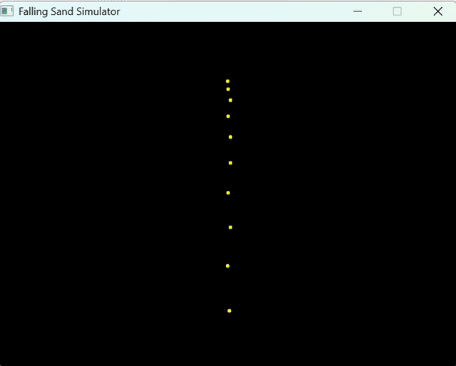
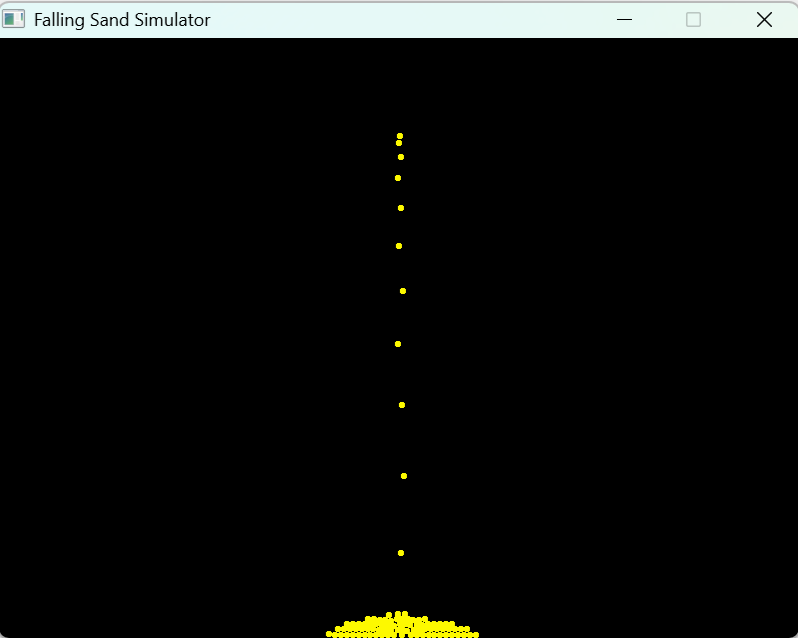
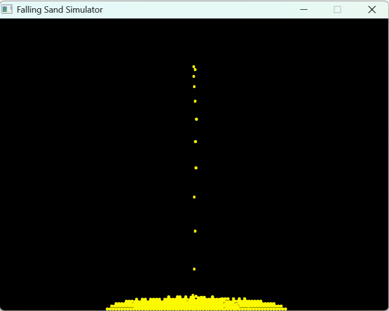

# Falling Sand Physics Engine

A real-time 2D granular physics engine implemented in C++ and rendered using Raylib. The project simulates discrete particle dynamics through cellular automata principles, handling particle movement, collision responses, and spatial interactions across an update grid.

## Demo

<p align="center">
  
</p>

## Screenshots

<table>
  <tr>
    <td align="center" width="50%">
      
      <br />
      <b>Particle Generation & Initial State</b>
    </td>
    <td align="center" width="50%">
      
      <br />
      <b>Grid Collision & Settled Particles</b>
    </td>
  </tr>
</table>

## Technical Highlights
- **Discrete Cellular Physics:** Grid-based simulation modeling granular behaviors (falling, sliding, lateral displacement).
- **Modular OOP Architecture:** Clean separation across classes (`World`, `Sand`, `Vector2D`).
- **Real-Time Graphics:** Hardware-accelerated 2D rendering pipeline powered by Raylib.
- **Optimization:** Grid-level spatial partitioning to minimize collision checks per frame.

## Technologies
- **Language:** C++17
- **Graphics:** [Raylib](https://www.raylib.com/)
- **Build Tool:** GCC / Make

## Getting Started

### Prerequisites

Ensure you have a C++17 compliant compiler and the **Raylib** library installed on your system:
- **GCC / Clang** (with C++17 support)
- **Raylib** (installed via package manager, Homebrew, or compiled from source)

### 1. Clone the Repository

```bash
git clone https://github.com/LucasCalegari06/Sand_Simulation.git
cd Sand_Simulation
```

### 2. Build

Compile the project linking the Raylib library:

```bash
g++ -std=c++17 main.cpp Sand.cpp Vector2D.cpp World.cpp -lraylib -o sand_simulation
```

### 3. Run

Launch the executable:

```bash
./sand_simulation
```
